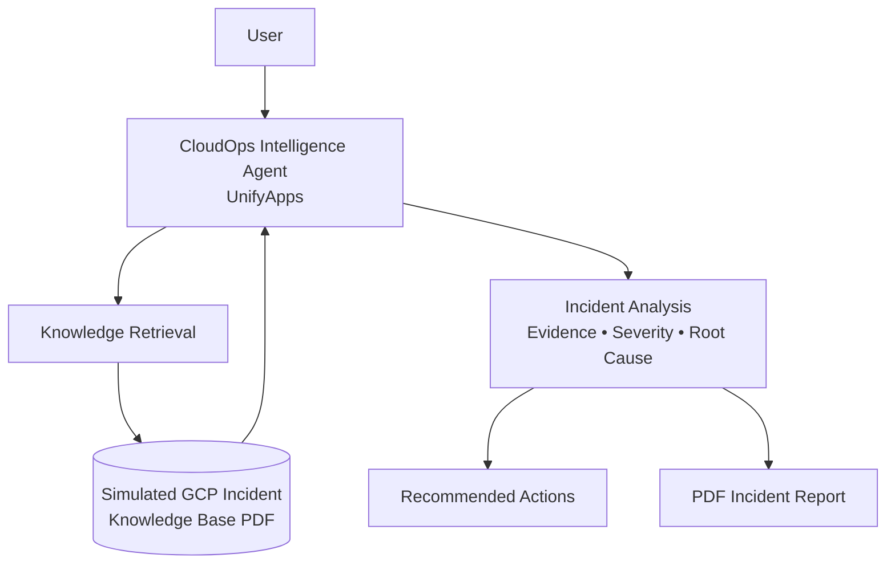

# ☁️ CloudOps Intelligence

### AI-Powered Google Cloud Incident Analysis Agent | Built with UnifyApps

   

## Overview

**CloudOps Intelligence** is a low-code AI agent developed with **UnifyApps** to demonstrate evidence-based incident investigation for **Google Cloud Platform (GCP)** services. It retrieves simulated incident records from a knowledge base, identifies affected services and potential root causes, compares severity levels, recommends remediation steps, and generates incident reports.

The project demonstrates an **AI-assisted CloudOps decision-support workflow** rather than a live cloud-monitoring or autonomous remediation system.

> **Scope:** All incidents and logs in this demo are simulated. The agent does **not** connect to live Google Cloud APIs, monitor production resources, or execute infrastructure changes.

## The Problem

Cloud incident investigations can require engineers to review logs, correlate configuration details, assess severity, and communicate recommended actions. This prototype explores how a knowledge-grounded AI agent can help organize those tasks and produce consistent investigation summaries.

## Key Features

- **Knowledge-grounded investigation:** Retrieves incident evidence from an uploaded document.
- **Root-cause analysis:** Distinguishes supported findings from suspected causes.
- **Severity and prioritization:** Compares incidents and recommends an investigation order.
- **Remediation guidance:** Suggests troubleshooting, verification, and prevention steps.
- **PDF reporting:** Generates an incident report with a summary and incident comparison.
- **Safety-focused configuration:** Includes instructions not to invent logs or claim real cloud access, plus configured guardrail capabilities.

## Architecture



**Workflow:** A user requests an investigation → the agent retrieves relevant knowledge-base evidence → analyzes the incident → returns an evidence-based explanation and recommended actions → optionally creates a report.

## Technology Stack

| Component | Technology |
| --- | --- |
| AI agent builder | UnifyApps |
| Approach | Low-code / Agentic AI workflow |
| Domain | Google Cloud operations (simulated) |
| Knowledge source | Uploaded PDF incident knowledge base |
| Output | Conversational analysis and PDF reports |
| Governance | Agent instructions and UnifyApps guardrails |

**GCP services represented in the demo:** Cloud Run, Cloud SQL, and Cloud Storage.

## Demo Incidents

The knowledge base contains three **fictional** incident scenarios:

| ID | Service | Severity | Investigation finding |
| --- | --- | --- | --- |
| `INC-001` | Cloud Run | High | Application listens on port `3000` while the configured ingress port is `8080` |
| `INC-002` | Cloud SQL | High | Connection pool saturation; underlying reason for connection retention or concurrency remains unconfirmed |
| `INC-003` | Cloud Storage | Medium | Workload identity lacks `storage.objects.create` permission on the target bucket in the supplied policy snapshot |

### Example Investigation

**Prompt**

```text
Investigate incident INC-001 using the uploaded knowledge base.
Identify the affected Google Cloud service, exact error message,
root cause, severity level, and recommended solution.
Explain your findings based on the available evidence.
```

**Expected evidence-based analysis**

- **Affected service:** Cloud Run (`payment-api`)
- **Severity:** High
- **Evidence:** The simulated container startup probe fails; the application listens on `3000` while the configured ingress port is `8080`.
- **Root cause:** The application uses a fixed port instead of the `PORT` environment variable.
- **Recommended action:** Update the application to listen on the configured `PORT` and `0.0.0.0`, then review and redeploy the corrected revision.
- **Verification:** Check revision readiness and successful HTTP responses after an approved change.

## Demonstrated Results

During interactive testing in UnifyApps, the agent:

1. Retrieved and analyzed the three simulated incident records.
2. Compared their services, severity levels, and root-cause evidence.
3. Distinguished confirmed evidence from hypotheses, particularly for the Cloud SQL scenario.
4. Generated a PDF incident report with an executive summary and incident comparison.

These are **functional demonstration outcomes**, not production accuracy benchmarks. No measured model accuracy, latency, or operational savings are claimed.

## Agent Safety and Limitations

- Incident data is simulated and must be labeled as such.
- Responses should rely on retrieved evidence and identify uncertainty.
- The agent must not claim to have accessed real GCP resources or performed repairs.
- Infrastructure and IAM changes are **recommendations only** and require human review.
- The current implementation is knowledge-based; it does not include live telemetry, API integrations, or autonomous remediation.
- Report formatting and optional chart generation may depend on enabled UnifyApps capabilities.

## How to Reproduce the Prototype

1. Create an AI agent in **UnifyApps** named `CloudOps Intelligence`.
2. Configure its role, goal, and instructions for simulated GCP incident investigation.
3. Upload a structured PDF knowledge base containing incident IDs, logs, findings, and recommended actions.
4. Enable the knowledge source and wait until processing completes.
5. Configure relevant document/report capabilities and safety guardrails.
6. Test individual incident investigation and multi-incident comparison in **Preview**.
7. Request a PDF report and inspect the generated output.
8. Publish a version after reviewing the results and access permissions.

> The UnifyApps workspace, permissions, and available capabilities may differ by account. The repository documents the prototype; it does not contain an exportable standalone implementation of the UnifyApps agent.

## Screenshots and Demo

Add screenshots or recordings of the following when available:

- Agent configuration and knowledge source
- `INC-001` investigation in Preview
- Comparison of `INC-001`, `INC-002`, and `INC-003`
- Generated PDF report

> Before sharing screenshots, remove account identifiers, private URLs, credentials, and other sensitive workspace details.

## Future Enhancements

- Integrate with **Google Cloud Logging** and **Cloud Monitoring** for authorized live incident data.
- Add scoped, read-only connectors and structured investigation tools.
- Introduce incident history, evidence citations, and more robust confidence evaluation.
- Add approval-gated remediation workflows with audit logging.
- Evaluate accuracy, grounding, false positives, and time-to-diagnosis against a labeled incident test set.

## Project Status

**V1 — Published in UnifyApps.** This repository is a portfolio and documentation showcase of the simulated prototype.

---

*CloudOps Intelligence — Exploring knowledge-grounded Agentic AI for cloud operations.*
